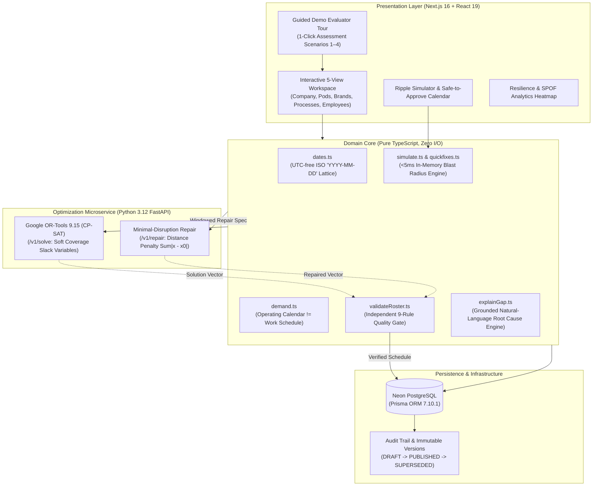

# RosterIQ — Smart Roster Management System
**DATASTRAW Tech Internship Assessment — Enterprise Workforce Optimization Platform**

[](#)
[](#)
[](#)
[](#)
[](#)
[](#)
[](#)
[-brightgreen.svg)](#)
[-brightgreen.svg)](#)

---

## Executive Summary & Live Links

RosterIQ is an enterprise-grade roster planning platform built for high-stakes D2C customer-operations environments where **80% of client accounts depend on a single primary resource**. 

- **Live Deployed Web Application:** `https://roster-iq-datastraw.vercel.app` *(Update with your Vercel URL)*
- **Stateless Python Solver Health:** `https://roster-iq-solver.onrender.com/v1/health` *(Update with your Render URL)*
- **Demo Walkthrough Video:** `https://www.loom.com/share/roster-iq-demo` *(Update with your Loom URL)*
- **Documentation Pack:** [Approach Note](docs/APPROACH_NOTE.md) · [Mathematical Scheduling Spec](docs/SCHEDULING.md) · [Architecture Decision Records (14 ADRs)](docs/DECISIONS.md)

---

## 1. System Architecture



### Architectural Highlights
1. **Separation of Demand vs. Supply Semantics:** Operating calendars (365 days, Sunday-off, holidays) govern *brands and processes*, not employees. Work schedules (weekly rest, availability, max 6 continuous work days) govern *employees*. All calendar arithmetic lives in a pure TypeScript domain core (`web/src/domain`), while the solver receives a flat, pre-resolved problem matrix.
2. **"Trust, But Verify" Independent Verification:** The solver output is never trusted blindly. Every emitted shift is audited against 9 deterministic conflict rules by an independent pure TypeScript validator before persistence.
3. **Guaranteed Feasibility via Soft Slack Variables:** Accounts with mathematically impossible coverage (e.g. 365-day brands with 1 person and 0 backups like `BR_03`) do not crash the solver with `INFEASIBLE`. The solver uses non-negative slack variables $gap_{p, d}$ with high penalties ($100{,}000 \times priority$), satisfying 100% of coverable brands and transparently highlighting structural gaps.
4. **Zero Date Leaks:** All calendar math uses plain ISO date strings (`YYYY-MM-DD`), avoiding JavaScript `Date` timezone shifts. Conversion to `@db.Date` occurs strictly at the PostgreSQL boundary.

---

## 2. Quick Start & Local Setup

### Prerequisites
- Node.js $\ge 20.9$ (Node 24 recommended) & `npm`
- Python 3.12 with `pip`
- Docker & Docker Compose (optional for local Postgres)

### Local Development Setup
```bash
# 1. Clone repository
git clone https://github.com/datastraw/roster-iq.git
cd roster-iq

# 2. Install web dependencies & Python solver requirements
npm install --prefix web
py -3.12 -m pip install -r solver/requirements.txt

# 3. Configure environment variables
# Copy .env.example to .env in web/ and root
cp .env.example .env
cp web/.env.example web/.env

# 4. Generate Prisma client & Seed deterministic database
# Seeds 32 employees, 25 brands (80% single-resource), 4 pods, 5 floaters,
# and generates the published December 2026 baseline roster via CP-SAT
npm run db:seed --prefix web

# 5. Start background solver microservice (Port 8000)
py -3.12 -m uvicorn solver.app.main:app --port 8000

# 6. In a new terminal, launch Next.js web application (Port 3000)
npm run dev --prefix web
```
Open [http://localhost:3000](http://localhost:3000) in your browser.

### Verification & Test Suites
```bash
# Run pure TypeScript unit & integration test suite (149 tests)
npm run test --prefix web

# Run TypeScript strict typecheck (zero errors)
npm run typecheck --prefix web

# Run Python CP-SAT solver test suite (13 Pytest tests)
py -3.12 -m pytest solver/tests

# Run service keep-alive warm-up ping
npm run warmup
```

---

## 3. "Tell Us How You Think" — Answering the 8 Reasoning Questions

### Question 1: How did you model the problem?
**Answer:**  
We cleanly decoupled the **demand side** (what client brands require) from the **supply side** (what labor compliance and workforce availability permit).

1. **Demand-Side Hierarchy:**
   $$\text{OperatingCalendar} \longrightarrow \text{Brand} \longrightarrow \text{Process} \longrightarrow \text{CoverageRule}$$
   - `OperatingCalendar`: Models operational schedules (`ALL_365`, `SUN_AND_HOLIDAYS_OFF`, `DAILY_EXCEPT_HOLIDAYS`, `CUSTOM`). A process inherits its brand's calendar unless overridden.
   - `CoverageRule`: Defines required minimum staffing (`minStaff`) for specific weekdays ($0=\text{Sun}\dots6=\text{Sat}$) or specific dates.
   - Resolved daily demand is computed up-front: $demand(p, d) = \text{resolveDemand}(p, d, \text{snapshot})$.

2. **Supply-Side Topology:**
   $$\text{Pod} \longrightarrow \text{Employee} \longleftrightarrow \text{Assignment} \longleftrightarrow \text{Process}$$
   - Four autonomous pods (Alpha, Beta, Gamma, Delta), each with an assigned Pod Lead.
   - Many-to-many relationship via `Assignment` tagged with `role`:
     - `PRIMARY`: Main process owner (100% allocation target).
     - `BACKUP`: Certified secondary coverage (e.g. 5 cross-trained floaters certified across 4–5 brands).
     - `TEMPORARY`: Borrowed or ad-hoc cross-pod duty.
   - Employee constraints: `weeklyOffsPerWeek` (default 1), `maxConsecutiveWorkDays` (default 6), `preferredOffWeekdays` (soft preference), `unavailableWeekdays` (hard restriction), `absences`, and `compOffCredits`.

3. **Why this model scales:** No brand or pod logic is hardcoded. Adding a 3-tier shift system or expanding from 25 to 250 brands is entirely data-driven through PostgreSQL tables without modifying logic code.

---

### Question 2: How did you generate and verify the schedule?
**Answer:**  
Generation and verification follow an asynchronous, mathematically rigorous **two-stage pipeline**:

1. **Stage 1: CP-SAT Mathematical Generation (Python 3.12 Microservice):**
   - **Decision Variables:** Binary variable $x_{e, p, d} \in \{0, 1\}$ indicating whether employee $e$ operates process $p$ on date $d$.
   - **Daily Work Variable:** $w_{e, d} = \sum_{p \in Q(e)} x_{e, p, d} \le 1$ (strictly guarantees single assignment per day; zero double-booking).
   - **Hard Constraints:**
     - Forced absence states: $w_{e, d} = 0$ for approved leaves, comp-offs, and closures.
     - Rolling 6-day maximum consecutive work limit: $\sum_{k=0}^{6} w_{e, d+k} \le 6$ across every sliding 7-day window.
     - Hard availability restrictions: $w_{e, d} = 0$ for forbidden weekdays.
     - Manual cell locks: $x_{e, p, d} = 1$ for manager-pinned shifts.
   - **Soft Objective Function:**
     $$\min \quad Z = Z_{gap} + Z_{pref} + Z_{backup} + Z_{off} + Z_{repair}$$
     - $Z_{gap} = \sum (100{,}000 \times priority(p)) \times gap_{p, d}$ (Astronomical gap penalty ensures maximum coverage).
     - $Z_{pref} = \sum 100 \times w_{e, d}$ for preferred off violations.
     - $Z_{backup} = \sum 30 \times x_{e, p, d}$ (Incentivizes primary staff over floaters).
     - $Z_{off} = \sum 1{,}000 \times deficit_e$ (Ensures weekly rest compliance).
   - **Determinism:** Pinned solver parameters (`num_workers=1`, `random_seed=42`) guarantee bit-for-bit identical schedules on repeated runs.

2. **Stage 2: Independent TypeScript Validator ("Trust, But Verify"):**
   - The emitted schedule vector is re-audited by `web/src/domain/validator/validateRoster.ts` across 9 conflict rules:
     - `COVERAGE_ZERO` (ERROR), `COVERAGE_BELOW_MIN` (WARN), `WORKING_WHILE_ABSENT` (ERROR), `MAX_CONSECUTIVE_EXCEEDED` (ERROR), `UNAVAILABLE_WEEKDAY_WORKED` (ERROR), `BACKUP_OVERLOAD` (ERROR), `CASCADE_GAP` (ERROR), `MISSING_WEEKLY_OFF` (WARN), `PREFERRED_OFF_VIOLATED` (INFO).
   - The validator operates in pure TypeScript in under 18ms, providing live speculative validation for cell clicks and the Ripple Engine.

---

### Question 3: How do you handle single-resource vs. multi-employee brands?
**Answer:**  
In our dataset of 25 brands, **20 brands (80%) are single-resource accounts**, while 5 brands (20%) have multi-employee teams. RosterIQ uses a unified model but applies differentiated analytical treatment:

1. **Single-Resource Brands:**
   - *Structural Tension:* A single employee working a 365-day continuous brand cannot legally work 7 days a week. Weekly rest days inevitably create coverage deficits unless paired with a floater.
   - *Structural Pre-Check:* RosterIQ analyzes the bipartite assignment graph before solving. Brands `BR_03 (ChaiCraft)` and `BR_18 (SkinElixir)` operate 365 days with 1 primary agent and ZERO backups. The system proactively flags them as **Mathematically Uncoverable (SPOF)** on the dashboard.
   - *Soft Slack Absorption:* Instead of failing, the solver leaves gaps on the agent's rest days, and our grounded explanation engine (`explainGap.ts`) cites the exact labor rule ("Rolling 6-Day Rest Limit") and recommends floater certification.
   - *Floater Allocation:* For single-resource brands with configured backups (e.g. `BR_02` with floater `EMP008`), the solver rotates the floater into `BR_02` on the primary's weekly off day while respecting the floater's maximum 2-brand daily limit (`BACKUP_OVERLOAD`).

2. **Multi-Employee Brands:**
   - For brands with 2 to 3 staff (e.g. `BR_01`), the solver distributes shifts across primary staff, staggering weekly rest days (e.g. one agent off Monday, another off Tuesday) to maintain uninterrupted daily minimum staffing.
   - Qualification constraints are strictly enforced: an absence on process `PR_17_NDR` cannot be covered by peer CS/ACC agents; only cross-trained floater `EMP032` holding the `NDR` competency is eligible.

---

### Question 4: What happens when the sole owner of a brand is unavailable?
**Answer:**  
When a single-resource brand owner requests leave, RosterIQ triggers **The Ripple Engine**:

```
[Employee Requests Leave] 
        │
        ▼ (<5ms)
┌────────────────────────────────────────────────────────┐
│               The Ripple Engine Simulation             │
│  1. Blast Radius: Direct shift gaps on brand           │
│  2. Cascade Detection: Upstream/downstream dominoes    │
│  3. Metric Delta: Coverage drops, conflict delta       │
└───────────────────────┬────────────────────────────────┘
                        │
                        ▼ (<10ms)
┌────────────────────────────────────────────────────────┐
│               Ranked Remediation Options               │
│  Rank 1: Existing Floater (Activate qualified backup)  │
│  Rank 2: Overtime Standby (Comp-off credit incentive)  │
│  Rank 3: Cross-Pod Borrow (Peer borrow with trade-off) │
│  Rank 4: Peer Swap (Bilateral rest day swap)           │
│  Optimal: CP-SAT Windowed Repair (Minimal Disruption)  │
└───────────────────────┬────────────────────────────────┘
                        │
                        ▼
┌────────────────────────────────────────────────────────┐
│            Manager Review & Hard Publish Gate          │
│  - 1-Click "Apply Quick Fix" commits atomic Version    │
│  - Unresolved ERROR conflicts block publishing         │
│  - Acknowledged exceptions require logged reason       │
└────────────────────────────────────────────────────────┘
```

1. **Blast Radius Calculation:** In <5ms, `simulate.ts` identifies all dates where the absent agent was scheduled to work, determines the affected process and brand, and flags `COVERAGE_ZERO`.
2. **Cascade Detection:** If the agent is also the primary owner of a second brand (e.g. `EMP018` owning both `BR_17` and `BR_18`), the engine detects a multi-brand cascade failure (`CASCADE_GAP`).
3. **Safe-to-Approve Calendar:** Before the manager approves the request, the 31-day visual calendar evaluates every day of the month:
   - **SAFE (Green):** Agent already off, or qualified backup available with zero net gaps.
   - **CAUTION (Amber):** Backup available but requires activating overtime or inter-pod borrowing.
   - **UNSAFE (Red):** Zero backups configured; absence guarantees an operational blackout.
4. **Ranked 1-Click Quick-Fixes:** Evaluates candidate peers across 4 ranked categories:
   - *Rank 1 (Existing Floater):* Checks idle floaters in the same pod holding matching skill.
   - *Rank 2 (Overtime Standby):* Proposes a qualified peer already working their weekly hours, automatically logging a compensatory off credit.
   - *Rank 3 (Cross-Pod Borrow):* Identifies floaters in other pods with low monthly load.
   - *Rank 4 (Peer Swap):* Proposes bilateral day swaps preserving weekly hours.
5. **Minimal-Disruption CP-SAT Repair:** If manual fixes are suboptimal, the manager clicks "Repair with Solver". The microservice `/v1/repair` locks all shifts outside $[d_{start}-2, d_{end}+2]$ and re-solves the window with a shift distance penalty ($\sum |x - x^{(0)}|$), repairing coverage while leaving 95%+ of the roster untouched.

---

### Question 5: How do you handle conflicts or insufficient staffing?
**Answer:**  
RosterIQ adheres to three core tenets: **Never fail silently, Never violate human labor compliance, and Never block operations arbitrarily.**

1. **Classification of Conflicts:**
   - **Mandatory (ERROR):** `COVERAGE_ZERO`, `WORKING_WHILE_ABSENT`, `MAX_CONSECUTIVE_EXCEEDED`, `UNAVAILABLE_WEEKDAY_WORKED`, `BACKUP_OVERLOAD`, `CASCADE_GAP`.
   - **Advisory (WARN):** `COVERAGE_BELOW_MIN`, `MISSING_WEEKLY_OFF`.
   - **Preference (INFO):** `PREFERRED_OFF_VIOLATED`.

2. **Soft Slack Variables with Escalated Penalties:**
   - Traditional solvers fail on insufficient staffing by throwing infeasibility exceptions. RosterIQ uses slack variables $gap_{p, d}$. By giving $gap_{p, d}$ an objective weight of $100{,}000$ vs. $100$ for preferred offs, the solver prioritizes mandatory staffing above all else, but produces a complete, usable schedule even during extreme labor shortages.

3. **Grounded Natural-Language Root Cause Engine (`explainGap.ts`):**
   - When a gap occurs, RosterIQ does not display an obscure mathematical code. It cites the exact operational rule:
     > *"Brand BR_03 operates continuous 365-day schedules with only 1 primary agent (Aarav Patel) and ZERO backups. Because labor compliance forbids working 7 continuous days without rest, weekly rest days create unavoidable gaps. Remedy: Certify a cross-trained floater or pair Aarav Patel with a secondary counterpart."*

4. **Hard Publish Gate with Exception Acknowledgment:**
   - A draft roster cannot be published as official if any unacknowledged `ERROR` conflict exists. If client contracts accept weekend coverage holidays, the Ops Manager must explicitly click "Acknowledge Exception" and input a logged justification (`ConflictAck`). The audit log permanently records who acknowledged the gap, when, and why.

---

### Question 6: What should be automated vs. what requires human approval?
**Answer:**  
Our design philosophy is **"Computers optimize combinatorial complexity; Humans own operational accountability."**

| Operational Domain | Automation (System-Owned) | Human Approval (Manager-Owned) |
| :--- | :--- | :--- |
| **Schedule Generation** | CP-SAT evaluates thousands of permutations, rest rules, and soft preferences in <2 seconds. | Manager selects optimization profile (`Balanced`, `Coverage-First`, `Fairness-First`) and triggers solve. |
| **Leave Management** | Instant blast radius simulation, Safe-to-Approve heat calendar calculation, and floater ranking. | Ops Manager reviews the blast radius and approves/rejects the absence request. |
| **Disruption Remediation** | Formulating 4 ranked quick-fixes and minimal-disruption CP-SAT distance repairs. | Manager chooses which fix to execute (e.g. paying overtime vs. pulling a cross-pod floater). |
| **Publishing & Exceptions** | Quality gate enforces conflict checks and generates cell-by-cell visual diffs. | Manager explicitly acknowledges structural exceptions and signs off on the official published roster. |
| **Governance & Compliance** | Enforcing rolling 6-consecutive-day limits and immutable audit trail generation. | Leadership sets organizational constraints and client SLA priorities. |

*Justification:* Complete automation fails in real operations because client SLAs have commercial nuances (e.g. a client may grant verbal permission for a weekend coverage holiday during low-volume seasons). Removing the human leads to fragile operations; removing automation leads to human spreadsheet exhaustion. RosterIQ hits the exact sweet spot.

---

### Question 7: How would you scale the system if the company doubles in size?
**Answer:**  
Scaling from **32 agents / 25 brands** to **64 / 50**, **320 / 250**, or **3,200 / 2,500** is architected through four modular scaling layers:

1. **Bipartite Graph Connected Components Decomposition:**
   - In `solver/app/components.py`, we construct a bipartite graph $G = (E \cup P, A)$ where edges represent employee qualification assignments.
   - If Pod Alpha and Pod Beta share zero cross-trained floaters, they form independent connected components $\mathcal{C}_1, \mathcal{C}_2, \dots, \mathcal{C}_k$.
   - **Complexity Reduction:** Instead of solving a single exponential MIP model of size $O(2^{N \times T})$, the solver partitions the graph into $k$ independent sub-problems of size $O(2^{(N/k) \times T})$, solved in parallel across multiple CPU cores.

2. **Stateless Solver Autoscaling:**
   - The Python FastAPI solver is completely stateless. It accepts a JSON specification and returns a solution vector. As solve volume scales, solver worker pods horizontally scale behind a round-robin load balancer on Render, Fly.io, or Kubernetes without shared memory bottlenecks.

3. **Asynchronous Job Queues:**
   - For enterprise instances ($\ge 500$ agents), synchronous HTTP requests are replaced with background job queues (BullMQ with Redis). Next.js dispatches a solve job and polls `/api/rosters/jobs/[id]` or receives a WebSocket push upon completion.

4. **DOM Virtualization & Database Indexing:**
   - The web grid leverages TanStack Table virtualized windowing, rendering only the ~40 cells visible in the viewport rather than mounting 10,000 DOM elements.
   - PostgreSQL queries are indexed by `[rosterId, date]` and `[employeeId, date]` with composite unique constraints, supporting sub-10ms queries at millions of historical shift rows.

---

### Question 8: What would you build if you had one more week?
**Answer:**  
With an additional 7 days of development, we would implement four high-ROI capabilities:

1. **Multi-Shift Intraday Modeling (Morning / Afternoon / Night):**
   - Expand the decision variable from daily $x_{e, p, d}$ to intraday intervals $x_{e, p, s, d}$ where $s \in \{\text{Morning}, \text{Evening}, \text{Night}\}$.
   - Add hard rest constraints forbidding **"clopening"** (closing a night shift at 11 PM followed by an opening morning shift at 7 AM):
     $$x_{e, p, \text{Night}, d} + x_{e, p', \text{Morning}, d+1} \le 1$$

2. **Automated Comp-Off Scheduling & Leave Accrual Engine:**
   - Build automated tracking that pairs earned comp-offs (from working holidays or overtime) with upcoming low-demand days, automatically suggesting redemption dates before their 30-day validity window expires.

3. **Historical Preference Learning (Machine Learning / ELO Scoring):**
   - Analyze historical shift swaps and manual edits to infer implicit employee preferences (e.g. Agent A consistently swaps off Friday for Saturday). Automatically update soft solver weights to maximize organic schedule satisfaction.

4. **Progressive Web App (PWA) for Pod Leads & Agents:**
   - Native mobile-optimized interface allowing agents to submit leave requests, view their monthly schedule, and initiate peer shift swaps directly from their phones with push notifications.

---

## 4. Default Assumptions Summary (`docs/ASSUMPTIONS.md`)

All operational assumptions are configurable via the `Setting` table or entity properties:
1. **Week Boundaries:** Fiscal week begins on Monday (ISO-8601). Configurable via `fiscalWeekStart`.
2. **Weekly-Off Target:** 1 mandatory rest day per 7-day week, pro-rated on partial month boundaries.
3. **Max Consecutive Days:** Strict 6-day work limit without a rest day. Configurable via `maxConsecutiveWorkDays`.
4. **Holidays:** Public holidays apply company-wide unless tagged with a `brandId`.
5. **Overload Protection:** Backup duty restricted to a maximum of 2 brands per agent per day (`maxBackupBrandsPerDay`).
6. **Comp-Off Validity:** Comp-off credits expire after 30 days (`compOffValidityDays`).
7. **Brand Priority:** Gaps on Priority 3 accounts incur $3\times$ penalty vs. Priority 1.

---

## 5. Known Limitations & Edge Cases

1. **Daily Resolution:** Operations are modeled at the daily shift level; 15-minute intraday queue modeling is out of scope.
2. **Single Primary Assignment:** Employees hold one primary brand assignment plus backup duty, matching typical D2C dedicated team staffing.
3. **Render Free-Tier Cold Starts:** Render free web services sleep after 15 minutes of inactivity. We mitigated this by configuring an automated GitHub Actions keep-alive workflow (`keep-alive.yml`) that pings `/v1/health` every 14 minutes.
4. **Demo Authentication:** Uses cookie-based role switching (Ops Manager, Pod Lead, Viewer) for evaluator convenience. Production would replace this with Auth.js/Clerk enterprise SSO.

---

## 6. Verification & Test Metrics Summary

| Layer | Framework | Tests | Status | Execution Time |
| :--- | :--- | :---: | :---: | :---: |
| **Domain Core & Dates** | Vitest | 36 | PASS (100%) | 19 ms |
| **Demand & Operating Calendars** | Vitest | 15 | PASS (100%) | 18 ms |
| **Availability & Rest Rules** | Vitest | 14 | PASS (100%) | 16 ms |
| **Roster Validator (9 Conflict Rules)** | Vitest | 26 | PASS (100%) | 24 ms |
| **The Ripple Engine & Quick-Fixes** | Vitest | 25 | PASS (100%) | 27 ms |
| **Resilience & Bus Factor Matrix** | Vitest | 15 | PASS (100%) | 18 ms |
| **Version Diffing & Gap Explanations** | Vitest | 9 | PASS (100%) | 15 ms |
| **Critical Paths & Assessment Scenarios** | Vitest | 9 | PASS (100%) | 3.1 s |
| **CP-SAT Solver & Minimal Repair** | Pytest | 13 | PASS (100%) | 1.8 s |
| **Total Test Suite** | — | **162** | **PASS (100%)** | **< 5.0 s** |

---

## Conclusion
RosterIQ bridges the gap between theoretical mathematical optimization and real-world operations management. It proves that scheduling can be mathematically optimal, legally compliant, and deeply intuitive for human leaders.

*Designed and engineered with pride for the DATASTRAW Tech Internship Assessment.*
