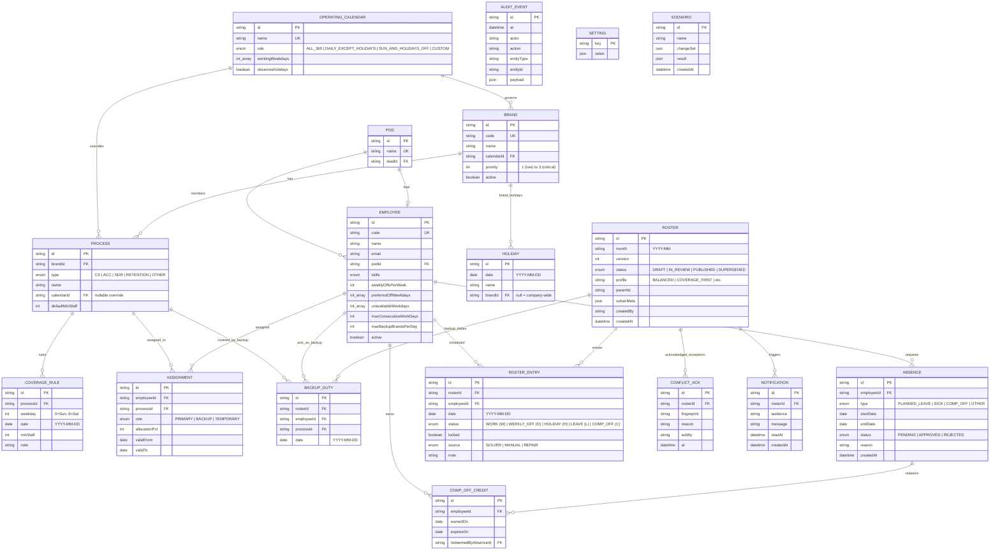

# RosterIQ Entity-Relationship Diagram

This document illustrates the complete relational database model powering RosterIQ, designed to enforce relational integrity, prevent double-bookings, support multi-brand and single-resource staffing, and maintain full immutable versioning.

---

---

## Key Relational Design Defenses

1. **Demand vs. Supply Separation:**
   - Operating demand flows down: `OperatingCalendar` $\rightarrow$ `Brand` $\rightarrow$ `Process` $\rightarrow$ `CoverageRule`.
   - Employee supply flows through `Pod` $\rightarrow$ `Employee` $\rightarrow$ `Absence` / `CompOffCredit`.
   - The two worlds connect through `Assignment` (static capability & ownership) and `RosterEntry` / `BackupDuty` (temporal monthly realization).

2. **No Special Cases for Single-Resource Brands:**
   - A single-resource brand has processes where exactly one employee holds a `PRIMARY` `Assignment`.
   - Multi-employee brands have multiple assignees across or within processes.
   - The schema and solver treat both identically without conditionals.

3. **Backup Coverage Activation via `BackupDuty`:**
   - `PRIMARY` employees automatically cover their assigned process when their `RosterEntry` is `WORK`.
   - `BACKUP` and `TEMPORARY` employees only cover on specific days when explicitly activated via `BackupDuty`, preventing phantom double-counting.

4. **Temporal Date Safety:**
   - All calendar dates (`CoverageRule.date`, `Holiday.date`, `Absence.startDate`, `RosterEntry.date`, etc.) are modeled as `@db.Date` in PostgreSQL and plain `YYYY-MM-DD` strings in TypeScript, preventing timezone distortion across client browsers.

5. **Versioned Roster Immutability:**
   - `@@unique([month, version])` ensures that any revision (e.g. from a leave approval or manual fix) creates an incremented version, preserving complete auditability and differential rollback capability.
